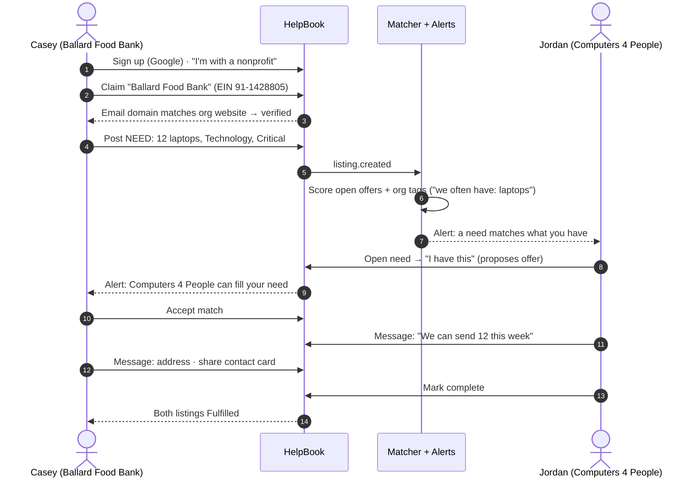
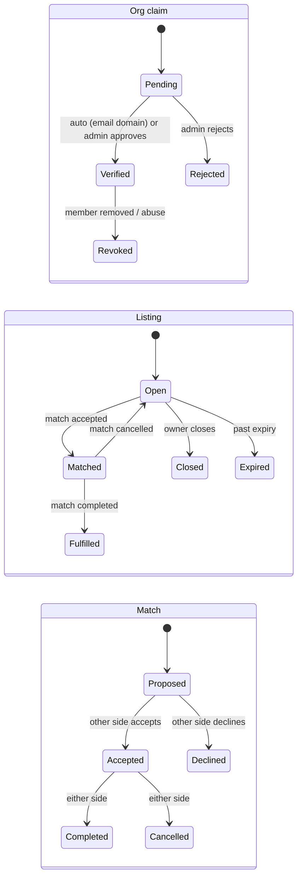
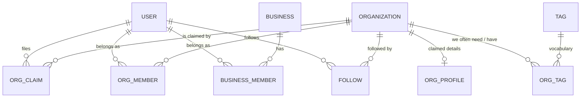
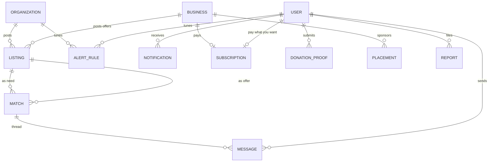

# HelpBook — Step 2 design (accounts, verification, alerts, money)

Draft for discussion, 2026-09-19. Shareable rendered version with wireframes: `docs/helpbook-step2-design.html` (published at https://claude.ai/artifact/Tev9dE62ksqfMLQLrqqXTv). Nothing here is implemented yet; the prototype covers listings, matching, propose/accept/complete, messaging, and the real-time feed.

## The "watch this" story

1. **Casey's intake laptops die.** Ballard Food Bank (EIN 91-1428805) can't register clients. Casey creates a HelpBook account — email or Google, one screen.
2. **Casey claims the org.** Types "Ballard Food" → the IRS record is already there. Verifies with a @ballardfoodbank.org email. No data entry.
3. **Casey posts a Need.** "12 laptops for client intake stations" — Technology, Critical. Can also browse every WA 501(c)(3), filtered by cause, city, size, tags.
4. **Jordan gets alerted.** Computers 4 People in Need has "we often have: laptops" on their profile. HelpBook scores the match and notifies Jordan (in-app, email, push).
5. **"I have this."** Jordan's existing offer of 15 laptops is proposed as the match. Casey accepts.
6. **They talk, then hand off.** Private thread, contact card, either side marks complete. Both listings Fulfilled; outcome recorded on both profiles.

Beats 3–6 run in the prototype today (minus alerts and contact cards). Step 2 adds 1–2, the alert in 4, org profiles/tags, business and supporter accounts, and the web UI.

## Account types

| | Nonprofit (501c3) | Business | Supporter | Admin |
|---|---|---|---|---|
| Cost | Free, always | Premium subscription (tiers TBD) | Pay-what-you-want, or proof of a donation to a WA 501c3 in the last 12 months | — |
| Verified how | Org claim: email-domain (instant), mailed code, document, member invite, admin | WA UBI lookup + email domain + payment method | Email + join gate | Staff |
| Can post | Needs and Offers | Offers; sponsored placements (allow-listed, reviewed) | v1 nothing; v2 "I can help" | — |
| Can message | Inside matches; collaborate threads | Nonprofits inside a match | v1 no | Anyone |
| Alerted on | Needs/Offers matching tags, category, area | Needs matching what they give | Orgs they follow | Claims, reports, placements |

Roles attach to memberships, not the person — one user can be on a nonprofit and own a business. Unverified nonprofit users browse and draft; posts/messages go live once verified (decision 1).

## Wireframes (W1–W10)

W1 Create account · W2 Claim your organization · W3 Home feed · W4 Browse organizations (IRS filters + verified/tags/open needs) · W5 Org profile with "we often need / we often have" tags · W6 Post a need (with "likely matches right now") · W7 Alert → need detail ("I have this" / "Let's collaborate") · W8 Match thread (share contact card, mark complete) · W9 Business account (offers, placements, subscription) · W10 Admin verification queue. See the HTML for the frames.

## Flow

```mermaid
flowchart TD
    A[Create account: email or Google] --> B{I'm here as…}
    B -->|Nonprofit| C[Search IRS-listed org by name or EIN]
    C --> D{Verify association}
    D -->|Email domain matches org website| E[Verified instantly]
    D -->|Mailed code / document / member invite| F[Pending → admin queue]
    F -->|approved| E
    F -->|rejected| G[Browse only]
    E --> H[Post needs & offers · message · free]
    B -->|Business| I[Business name + WA UBI lookup + email domain]
    I --> J[Choose plan · add payment]
    J --> K[Post offers · request sponsored placements]
    B -->|Supporter| L{Join gate}
    L -->|Pay what you want| N[Follow orgs · get alerts]
    L -->|Donation receipt to a WA 501c3| M[Proof → admin queue] --> N
```

## Data model (additions to the prototype)

People, organizations, verification:

Exchange, alerts, money, moderation:

Entity notes:
- `USER` (id, email, display_name, auth_provider, account_types[], created_at) — ASP.NET Identity.
- `ORG_CLAIM` (user, ein, method: email_domain | mailed_code | document | member_invite | admin, status: pending | verified | rejected | revoked, evidence_ref, reviewed_by). Evidence is a reference, never inline PII.
- `ORG_MEMBER` (user, ein, role: owner | editor | viewer). `ORG_PROFILE` (ein, mission, website, public_contact, logo_url).
- `TAG` (name, kind: need | have | cause) shared vocabulary; `ORG_TAG` (ein, tag, kind).
- `BUSINESS` (name, ubi, domain, status), `BUSINESS_MEMBER`, `SUBSCRIPTION` (owner_type business|user, tier local|regional|pwyw, amount, stripe_id, status, renews_at), `DONATION_PROOF` (user, recipient ein, donated_on, evidence_ref, status).
- `LISTING` gains `owner_type` (org | business) + `owner_id`; `MESSAGE.sender` becomes a user id.
- `ALERT_RULE` (owner org|user, categories, keywords, radius_miles, channels), `NOTIFICATION` (user, type, payload_json, read_at), `FOLLOW` (user, ein).
- `PLACEMENT` (business, type: sponsored_offer | need_sponsorship | category_sponsor | directory_card, target, status pending|approved|live|ended|rejected, dates). `REPORT` (reporter, target, reason, status).
- `ORGANIZATION.is_active` = in Pub 78 and not on the auto-revocation list (phase 2b).

## Verification methods (pluggable via `OrgClaim.method`)

| Method | How | Speed | Strength | Data we have |
|---|---|---|---|---|
| Email domain | Sign-up email domain = org website domain on file | Instant | Good for orgs with a domain | Website from IRS 990-N / 990 XML |
| Mailed code | Postcard code to IRS-registered address | ~1 week | Strong | Address for all orgs |
| Document upload | IRS determination letter / WA charity registration | Admin, 1–2 days | Strong, manual | EIN must match |
| Member invite | Verified Owner invites a colleague | Instant | Inherits trust | — |
| Admin | Phone verification via WA SOS number | Days | Strong fallback | SOS extract (public-records request) |

Businesses: WA UBI lookup + email domain + payment method. Supporters: email + PWYW payment or donation-proof review.

## Money & placements

- Nonprofits pay nothing. Businesses: subscription (proposal: Local / Regional tiers). Supporters: pay-what-you-want (floor TBD) or donation proof.
- Placement allow-list: sponsored offer (pinned in its category), need sponsorship ("Fulfilled thanks to X" on completed matches), category sponsor banner (one at a time), directory card. Admin-reviewed, labeled "Sponsored", tied to giving; never in private threads.
- **Compliance:** HelpBook charges for its own service and never collects or routes donations to nonprofits (RCW 19.09 commercial-fundraiser exposure; money-transmitter questions). Donation proof is evidence of a gift made elsewhere.

## Matching & alerts (extending `MatchScorer`)

Add org capability tags ("we often have"), NTEE cause relatedness (learned from completed matches), county/radius geography (ZIP centroids first), and history. Each org gets a default `AlertRule` from tags + category + area; in-app always, email/push opt-in; digest for low urgency, immediate for Critical.

## Decisions before building

1. Unverified nonprofit users: browse + draft only (proposed) vs. post with badge.
2. PWYW floor: $0 allowed (proposed) vs. $1 with card.
3. Supporters responding to needs: not in v1 (proposed).
4. Business tiers and prices; free trial?
5. Confirm the four placement types; is category sponsor exclusive?
6. "Let's collaborate" threads without a listing: yes (proposed), rate-limited.
7. Geography unit: county + ZIP-centroid radius (proposed).
8. Name check for "HelpBook" (trademark/domain).
9. Web framework: Blazor (shares C# DTOs) vs. React — decide after wireframe sign-off.

## Step 2 plan (each phase shippable and demoable via API + CLI)

- **2a Identity & accounts** — ASP.NET Identity (Google + email), `User` with account types, permission-based policies; `X-Org-Ein` replaced by login memberships. Nothing below controllers changes.
- **2b Org claiming & verification** — `OrgClaim` + pluggable methods; email-domain auto-verify from 990-N websites; Pub 78 + revocation → `is_active`; admin queue; `OrgMember` roles + invites. *Beats 1–2.*
- **2c Profiles, tags, directory** — `OrgProfile`, `Tag`/`OrgTag`, directory filters (IRS + HelpBook), follow. *W4, W5.*
- **2d Alerts & notifications** — `AlertRule`, `Notification`, matcher with org tags + geography; in-app + SendGrid email, push-ready. *Beat 4.*
- **2e Collaborate threads & contact cards** — org-to-org threads without a listing; share contact; completed-match history on profiles.
- **2f Business accounts** — `Business`, UBI verification, Stripe Billing, business-owned offers, `Placement` review + labeling. *W9.*
- **2g Supporters** — PWYW via Stripe Checkout, donation-proof upload/review, follows, off-platform donate links.
- **2h Web app** — framework after wireframe sign-off; W1–W10 on the API + SignalR hub; mobile later on the same contracts.
- **Throughout** — moderation/reporting, listing expiry job, audit log, per-account-type rate limits, privacy rules (IRS "in care of" and SOS officer contacts never public).
